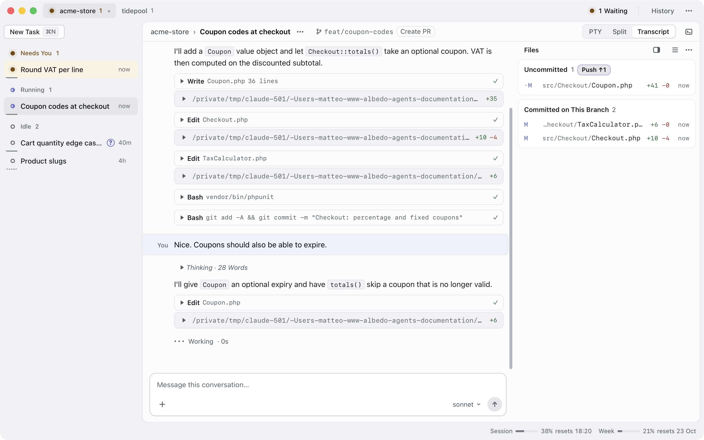
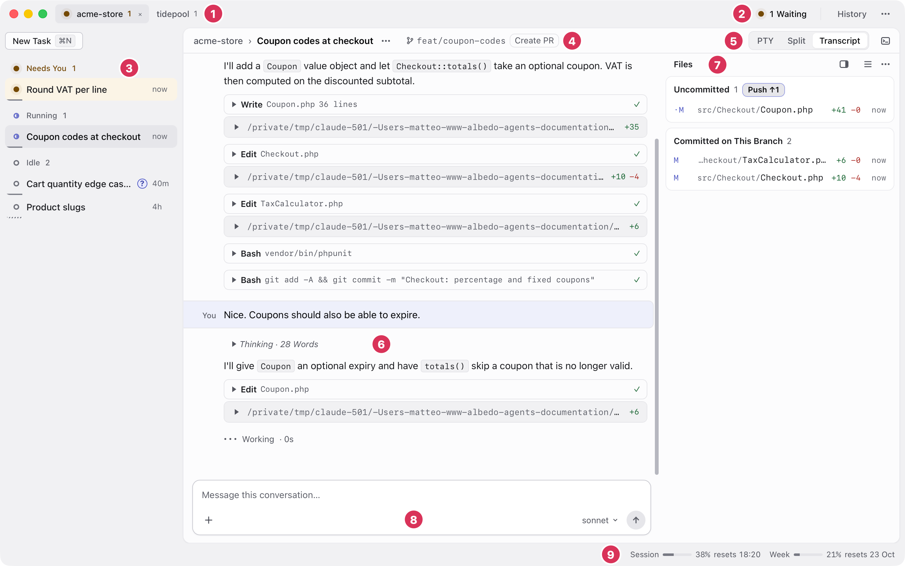
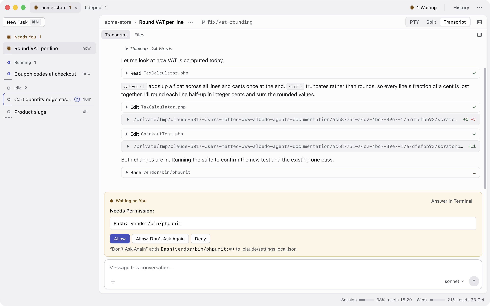
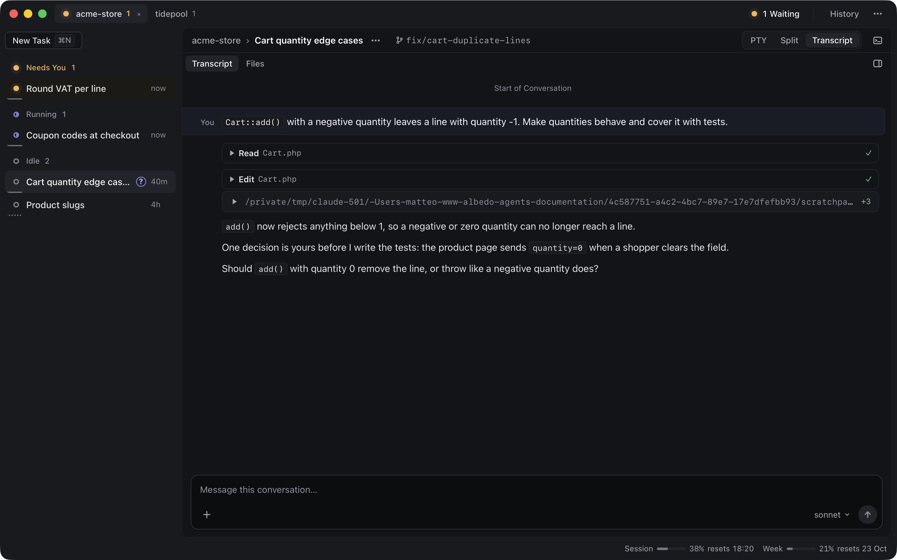

# Albedo

A desktop cockpit for running several Claude Code sessions at once.

Each piece of work is a **task**: its own branch, its own git worktree, and its
own Claude Code session. Albedo keeps them side by side, tells you which one is
waiting on you, and gives you a readable view of what each has done.

Albedo wraps Claude Code and never replaces it. Every task runs the real
`claude` in an embedded terminal, exactly as it would in your shell, so your
settings, hooks, skills, MCP servers and subscription all apply unchanged.



- [Opinionated by design](#opinionated-by-design)
- [Requirements](#requirements)
- [Install](#install)
- [Getting started](#getting-started)
- [The window](#the-window)
- [What it does](#what-it-does)
- [Good to know](#good-to-know)
- [Keyboard shortcuts](#keyboard-shortcuts)
- [Troubleshooting](#troubleshooting)

## Opinionated by design

Albedo is built around one way of working, and it does not try to support
every other one. Know these choices before you adopt it.

- **Claude Code only.** Albedo runs the `claude` CLI and reads its session
  files. It does not run other coding agents, and it does not call the
  Anthropic API on its own.
- **One task, one git worktree.** Parallel tasks stay out of each other's way
  because each has its own branch and folder. Albedo creates, moves and
  cleans up those worktrees for you. Repositories that are not in git cannot
  be used.
- **GitHub for pull requests.** The PR badge, its checks and the merged
  follow-up read from GitHub through `gh`. Albedo works with other git hosts,
  but without any pull request status.
- **PHP for code intelligence.** Go to Declaration and Find Usages are
  type-aware only for PHP, through PHPantom, and Go to Implementation is
  PHP only. Every other language gets the
  same commands through text search (git grep), and there is no completion
  or diagnostics for any language.
- **A cockpit, not an IDE.** Albedo has an editor for reading changes and
  making small fixes. Your own editor stays where real editing happens.
- **macOS first.** It is used daily on macOS. Linux builds and is tested in
  CI, and Windows runs it as a Linux app under WSL2.

These describe what Albedo does today, not a policy. Support for other agents,
hosts or languages is welcome as a contribution; see
[CONTRIBUTING.md](CONTRIBUTING.md).

## Requirements

Albedo runs on macOS and Linux, and on Windows as a Linux app under WSL2 (see
[docs/LINUX-WSL.md](docs/LINUX-WSL.md)).

| Tool | Needed for | Without it |
| --- | --- | --- |
| [Claude Code](https://claude.com/claude-code) (`claude`), signed in | Every task: Albedo runs it in the terminal | Nothing works |
| `git` | Worktrees, branches, the Files panel, Quick Open, Find in Files | Nothing works |
| [GitHub CLI](https://cli.github.com) (`gh`), signed in with `gh auth login` | The pull request badge: state, checks, reviews, merged; Squash and Merge | No PR status, and no hint saying why. Push and Create PR still work, because Claude runs `git` and `gh` itself in the terminal |
| [PHPantom](https://github.com/PHPantom-dev/phpantom_lsp), optional | Type-aware Go to Declaration, Find Usages and Go to Implementation in PHP | Navigation falls back to git grep |

To build Albedo you also need Node 22 or newer and a Rust toolchain
(`rustup`). On Linux, Tauri needs a few system libraries; the build script
prints the exact `apt-get` line if they are missing.

## Install

```sh
git clone https://github.com/bits4breakfast/albedo.git
cd albedo
./build.sh --install
```

The script checks the prerequisites, runs the tests, builds the app (`.app` on
macOS, `.deb` on Linux) and installs it: into `/Applications` on macOS, through
`apt` on Linux. Nothing is installed behind your back: a missing prerequisite
is reported with the command to run, and the script stops.

| Option | Does |
| --- | --- |
| `--with-phpantom` | Bundles PHPantom into the app (about 48 MB) |
| `--skip-checks` | Builds without running the type check and tests |
| `--help` | Lists everything |

Without `--install`, the built app and installers are left in
`src-tauri/target/release/bundle/`.

To install PHPantom separately instead of bundling it, run
`scripts/install-phpantom.sh`. It downloads a pinned release, checks its
SHA-256, and puts it in `~/.albedo/bin`. Albedo itself never downloads
anything.

## Getting started

1. **Add a project.** A project is a git repository Albedo cuts worktrees
   from. On first launch, click **Add a Project**; later, use
   **⋯ › Projects…**. Albedo can also create projects from the repositories
   your past Claude Code sessions ran in.
2. **Check the project's settings.**
   - **Worktree root**: where task worktrees go. It defaults to
     `~/agents/<project>`, outside the repository, so worktrees never show up
     as untracked files in your main checkout.
   - **Default base branch**: what new branches start from.
   - **Initial Prompt**, optional: text typed into every new session. It can
     use `{key}`, `{rest}`, `{title}` and `{branch}`.
   - **CI Details**: what a failing check carries when it waits for Claude.
     **Name and Link Only** (the default), **GitHub Actions** (the failing
     step and the last 40 log lines), or **A Command** of your own; see
     [CI details from a command](#ci-details-from-a-command).
3. **Create a task** with **⌘N**. Give it a title, pick a new or existing
   branch, and choose a new worktree or the main checkout. **⌘↩** creates it.
   Claude Code starts in the new worktree.
4. **Work as you normally would** in the terminal, or switch to the Transcript
   view (**⌘\\**) and write from the composer under it.

If the title starts with an issue key such as `ACME-142`, Albedo uses it in
the branch and folder names, and the Initial Prompt can name it with `{key}`
so Claude looks the issue up. Albedo itself never talks to an issue tracker: Claude Code
does that through its own MCP servers, so no tracker credentials end up in
Albedo.

## The window



1. **Project tabs.** One per repository, with a count of tasks waiting on you.
   Each tab lists its own project's tasks and remembers where you were in it.
   **⌥1–9** switches, **⇧⌘[** / **⇧⌘]** step through them. Tabs appear once
   there are two projects; a closed tab comes back from the closed-projects
   menu. Click the active tab, or the project name in the task header, for
   the **project view**: the main checkout's files, read only, with **New
   Task**.
2. **Title bar actions.** **N Waiting** jumps to the next task that needs you.
   **N Requests** lists what sessions asked for (see "Good to know").
   **History** opens past sessions. **⋯** holds Projects, Worktrees, the theme
   (Auto, Light or Dark), Collapse Task List, Notify About PRs, Keyboard
   Shortcuts and What's New.
3. **Task list.** Two tabs. **Building** holds your tasks, grouped by what
   they need from you (see "See every session at a glance"), with the time
   since their last activity; **+** (**⌘N**) starts a new one. **Reviewing**
   lists the pull requests asking for your review (see "Pull requests
   waiting on your review"). Hover a task for its one-line summary. **⌘1–9** jumps to a task and **⌘[** /
   **⌘]** step through them. Each row's menu renames the task, marks it done
   or not done, copies the worktree path or session ID, moves, archives or
   deletes it. **⌥⌘T**, or the **‹** beside **+**, collapses the list to
   a narrow rail with one circle per group and its count; click a circle for
   its tasks.
4. **Task header.** Project, task title, the task's own menu (**⋯**), its
   branch, and the next step for the branch: Push, Create PR, or the open
   pull request. The menu holds **Rename Task…** (**⇧F6** or **F2**, or
   double-click the title), **Remind Me…**, **Make Available Remotely**
   (**⇧⌘R**) and **Compact Now**.
5. **Layout.** **PTY** shows only the terminal, **Transcript** only the
   reading pane, **Split** both, side by side or stacked. **⌘\\** cycles
   through them. The icon next to it opens a shell in the main checkout (**⌥F12**).
6. **Transcript.** The conversation, read from Claude Code's session files:
   your messages, Claude's replies, tool calls and diffs.
7. **Files.** What this task changed: uncommitted changes, then commits on
   the branch. It can be a tab next to Transcript or, as here, a pinned
   column.
8. **Composer.** Write to Claude without going to the terminal. **+** or
   **⌘U** attaches files, **⌘V** pastes a screenshot, and **@** mentions
   another task or a file. The word after **+** is the session's permission
   mode (Ask, Auto, Plan…), and the menu on the right changes the model.
9. **Status strip.** Your plan's **Session** (five-hour) and **Week** usage,
   with the time each one resets.

## What it does

### See every session at a glance

The task list groups tasks by what they need from you, most urgent first:

| Group | A task is here when |
| --- | --- |
| **Needs You** | It is waiting on a prompt, or its pull request's checks failed |
| **Running** | Claude is working |
| **Ready to Review** | A turn finished since you last opened it, with commits, changes or an open pull request on its branch |
| **My Review** | You have started ticking files Reviewed in its Review Guide, and no pull request is up for review |
| **Awaiting Review** | Its pull request is open, with no review yet |
| **In Review** | Its pull request has changes requested or review threads; the row shows how many threads are unresolved |
| **Approved** | Its pull request is approved |
| **Idle** | Anything else that is still live |
| **Done** | Marked done, or its pull request merged |

Archived tasks sit below them. A task that ends its turn on a question gets a
**?** mark, so you can tell it is waiting for a decision rather than
finished. When Needs You or Ready to Review grows, its group pulses briefly.

When a task gets blocked or finishes while you are looking elsewhere, the dock
icon bounces, the row pulses, and a system notification says which task and
why.

### Pull requests waiting on your review

The task list's **Reviewing** tab lists the open pull requests in the project
that ask for your review, by name or through one of your teams, and the ones
you have reviewed that are now waiting on their author. Each row shows the
author, the size of the change and what is new:

| Group | A pull request is here when |
| --- | --- |
| **New Activity** | Something happened since you last opened it or reviewed it: new commits, a force-push, comments by others, or your review asked for again. Newest first, with a dot |
| **Requested** | Your review is asked for and nothing is new. Newest request first |
| **Reviewed · Waiting on Author** | You reviewed it and nothing has happened since |

The tab's count is what waits on you: every request, plus reviewed pull
requests with something new, and opening a pull request counts as having
seen what is there.

Click a pull request to review it in Albedo. The first click checks it out
as a **review task**: Albedo fetches its head into a local branch
`review/<number>` (forks included), with no upstream so nothing can be pushed
from it, in a worktree of its own, measured against the pull request's base.
After that a click selects the task. A review task has the Transcript, Files
and Guide tabs like any other, and a Claude Code session to ask about the
change, which is told to explain and answer and never to edit files, commit,
push or post anything on GitHub. The task header links to the pull request.
There is no Push, Create PR or Squash on it, and archiving removes the
worktree and the `review/<number>` copy. Review tasks whose pull request is
merged, closed or no longer asking for you stay at the end of the tab, so you
can still read and archive them. Albedo asks GitHub once a
minute through `gh`, in one request for the whole list, and not while the
window is hidden.

### Answer permission prompts without hunting for the terminal

When Claude Code asks for permission, the question appears as a card under the
transcript: **Allow**, **Deny**, or **Allow, Don't Ask Again**. The last one
adds the rule Claude Code suggests and tells you exactly which rule and which
settings file. When Claude asks a question with options, the options are
buttons, plus a field for your own answer.

When the question names a plan file (Markdown), the card shows the plan as a
document. Select a passage and click **Comment** to note what should change,
then **Send N Comments** answers with all of them at once. Claude Code's own plan
mode shows the same way, with **Approve** and **Keep Planning**.



### Read the session instead of scrolling a terminal

Tool calls are compact rows, thinking folds away, and edits open into diffs
with word-level highlighting. Click any file path to open the file. Code
blocks and inline code have a copy icon. **⌘↓** jumps to the latest
message.

While a turn runs, the line under it says what Claude is doing right now
("Running Bash npm test", "Thinking") with the turn's time and tokens.

When Claude starts subagents, a strip above the transcript shows them, and
clicking one opens that agent's own transcript. **Esc** goes back. Work left
running in the background (shells, async agents, wake-up timers) is listed
above the message box while it runs; click a line to find the call that
started it.

From the composer you can also **Clear** or **Compact Now** the task's
context. A compaction shows as one divider with its summary folded under it,
and the context reading turns to "compacts soon" from 90%.



### Write to Claude from the message box

- **@** opens "Mention a task or a file": another open task, or a file or
  folder in this worktree. It is sent as a reference Claude can follow, and
  shows as a chip in the transcript that opens the task or the file.
- A long paste folds into a token, `[Pasted text #1 +42 lines]`, with
  **View** and **Remove** under the box, as Claude Code does it.
- **Messages wait for the turn.** Anything sent while Claude is working (a
  message, a slash command, Push, the model picker) is held and goes in when
  the turn ends, so it can never land in a question Claude asks next.
  Several held messages go as one, as Claude Code's own queue does; a slash
  command always goes on its own. Held messages show in the Queued band
  with **Send Now**, **Edit** and **Remove**. Offline, they are kept and
  sent when the connection is back.

### Comment on the conversation, then answer in one go

Select a passage anywhere in the transcript (Claude's reply, your own
message, a tool's output) and click **Comment**, or press **⌘'**. Comments
collect above the message box ("3 Comments go with your next message") while
you read on, together with your comments on the code (below), and **Send**
sends them all, each quoting its passage, followed by whatever is in the box.
In the transcript, a quote opens the passage it came from.

### Reminders

**⋯ › Remind Me…** on a task sets a reminder: some text and a time ("tomorrow
9:00"). At that time it comes back on the task as a card, with a banner if
Albedo is in the background: **Snooze**, **Dismiss**, **Edit…** or **Send to
Claude**. A reminder due while Albedo was closed comes back on the next
launch. Sessions can set one too (see "Good to know").

### Worktrees without the cleanup

- **New Task** cuts a fresh branch into its own worktree, checks out an
  existing branch (including a colleague's, as `origin/their-branch`), or
  uses the main checkout.
- **Chat — No Branch**, the other kind of New Task, is a conversation about
  the code: Claude runs in the main checkout exactly as it is, and nothing is
  created or switched. Every start tells Claude not to change files there;
  tickets, documents or pages through MCP are fine. A chat has no Push,
  pull request or Move, and archiving it removes nothing.
- **Move** takes a task between its worktree and the main checkout, with the
  same branch, the same conversation and the uncommitted changes.
- **Archive** and **Delete** ask what should happen to the worktree and the
  branch. The conversation is kept either way.
- **⋯ › Worktrees…** finds worktrees left behind: orphaned, locked, or with
  uncommitted changes.

### Review what changed

- **Files** lists every file the task touched, with line counts, either for
  the whole branch at once or grouped commit by commit.
- The **Editor** opens files in tabs. **⇧⌘D** switches between the file as it
  is now and this task's change to it. **⌘S** saves, and if Claude changed
  the file on disk since you opened it, Albedo refuses to overwrite it and
  says so.
- The button at the top of Files moves the branch along: **Push**, then
  **Create PR**, then the pull request with its checks. **⇧⌘P** pushes,
  committing first if needed. **Squash & Rebase…** is in the menu next to it.
  A branch with a pull request is measured against the branch it merges
  into, not the project's default base.
- Click the pull request badge for **Checks**: every check, failing first,
  an Actions job's steps, and for a failed step the end of its log and its
  annotations, which open the file at that line. **Ask Claude to Fix…** puts
  a prompt in the message box for you to read and send.
- Beside the badge, the review state: **Approved**, **Changes Requested** or
  **Awaiting Review**; hover for who said what.
- When the pull request is approved, its checks pass and GitHub says it can
  merge, the task bar offers **Squash and Merge…**: it confirms the commits
  that become one and, if you leave it ticked, deletes the branch on GitHub
  afterwards. When GitHub reports conflicts, **⚠ Conflicts** asks Claude to
  rebase onto the base, resolve them, run the tests and push.
- When the checks fail, the failure waits above the message box ("✗ CI
  failed · 2 checks"), each check with a link to its details, and goes to
  Claude with your next message, or on its own with **Send**. **Remove**
  drops it.
- When a pull request's checks finish or a review lands while you are
  elsewhere, a banner says so, and the task row is marked until you open it.
  **⋯ › Notify About PRs: Checks and Reviews** turns the banners off.
- When the pull request is merged, the task offers a follow-up task, archiving
  and deleting.

### Read the change in a Review Guide

Every task on a branch has a **Guide** tab beside Transcript and Files;
**⇧⌘G**, the book icon at the top of Files, or **⋯ › Review Guide** also
switch to it. It is a guide to the task's branch: its changes grouped by what they do, in reading
order, each group with a short summary, a line on why each larger file
changes, and the group's diffs beside it. The header gives the change's
total files and +/− lines against the base. **Write Guide** runs Claude Code
once on Haiku, with no tools (see "Good to know").

- Tick files or whole groups **Reviewed**; **⌥↩** marks the group and moves
  to the next one not yet reviewed. The rail on the side shows how far you
  are ("4 of 10"). Ticked work comes back unticked if it changes.
- **⌥↑** / **⌥↓** move between groups, **↑** / **↓** between files.
- Comments you leave in the guide are marked on the file, its diff, the rail
  and the lines, and **Send N Comments** (**⌘↩**) sends them and shows the
  transcript.
- When the branch moves on, the guide says how many files changed since and
  offers **Rewrite**. New changes it does not know yet are under Unsorted.
- **Read · Map** in the guide's toolbar switches to a map of the change: a
  box per changed file in its group's colour, with a bar for its size and a
  mark for open comments, and arrows for the imports between them (read from
  the files themselves for TypeScript/JavaScript, PHP and Rust; no model).
  An unchanged file shows, dashed, when two or more changed files import it.
  Click a box to read its blocks, or a group in the key to open that group.
  A change of more than 60 files is drawn one box per folder.
  In a narrow pane the key goes above the map, and Read · Map and
  Uncommitted Only move into the toolbar's **⋯**.

### Review the change, then send all your comments at once

Review a task's work the way you would review a pull request: leave comments
on the code as you read, and hand them to Claude together when you are done.
Nothing reaches Claude until you send it.

1. **Comment as you read.** In the editor, select lines and press **⌥⌘M**. In
   the diff view, and in the Review Guide's diffs, press or drag the **+**
   next to the lines. Comments are saved in Albedo's database, so they
   survive a restart.
2. **Collect.** Every comment waits above the message box with your
   transcript comments, and in the **Comments** section of the Files panel
   (**Waiting**, **Sent**, **Resolved**). Click one to jump back to its
   lines.
3. **Send in one go.** **Send** in the message box sends every waiting
   comment, each with its file, its lines, the code it points at and your
   note, under a short intro, followed by what you typed. **Send** in the
   Files panel, or **⇧⌘S** from anywhere, sends them on their own and shows
   the transcript. **Intro…** changes the intro text, and Albedo remembers
   your version.
4. **Follow up.** A comment is marked **Sent** only once a message carrying it
   has actually gone to Claude. Click **✓ Resolve** once it has been dealt
   with; a sent comment whose lines then change resolves itself, and
   **Reopen** brings it back.

Comments are anchored to the text of the lines, not to line numbers, so they
stay on the right code while Claude edits the file around them. If the lines
themselves change before you send it, the comment is listed as outdated
instead of being pinned to the wrong code.

### Find your way around the code

- **⇧⇧** Search Everywhere, **⇧⌘O** Go to File (`:42` jumps to a line),
  **⌘O** Go to Class, **⌥⌘O** Go to Symbol.
- **⇧⌘F** Find in Files, with match case (**⌥C**) and regex (**⌥X**).
- **⌘B** or **⌘-click** Go to Declaration (on a declaration, its usages),
  **⌥F7** Find Usages.
- **⌥⌘B** Go to Implementation, in PHP: on an interface the classes that
  implement it, on a class its subclasses, on a trait the classes that use
  it.
- A single result always opens straight away, never as a one-row list.
- **⌥F12** or **⌘T** opens a shell drawer in the main checkout. It keeps
  running while hidden.

### Get back to old conversations

**History** searches the full text of every conversation Albedo has captured,
and also lists Claude Code sessions it has not imported yet. Resume or fork any
of them into a task. If the session's worktree is gone, Albedo can recreate it,
use a checkout that has the branch, or resume in another folder.

## Good to know

**Albedo shows what Claude Code wrote down, not what the terminal drew.** The
transcript, statuses and diffs come from the session files Claude Code saves
on disk. Terminal output is never parsed, so a Claude Code update that changes
how the terminal looks cannot break Albedo's view of a session.

**Running means activity in the last 90 seconds.** A task with nothing new for
longer is Idle, unless it is waiting on you.

**The waiting card and the terminal prompt are the same prompt.** Answer
whichever is closer. If you answer in the terminal first, the card goes away
and a late click on it does nothing, so a prompt can never be answered twice.
The card can pass on an answer for an hour. A prompt still open after that
stays under Needs You, and the card says to answer it in the terminal.

**A task follows its session.** Typing `/clear` or `/resume` inside Claude Code
moves the task to the new session, and restarting Albedo resumes the session
the task was on.

**Your subscription, never the API.** Albedo removes `ANTHROPIC_API_KEY` from
every session it starts. An inherited key would silently bill the API instead
of your Claude subscription.

**The Review Guide is the one time Albedo runs Claude Code itself.** Write
Guide and Rewrite run `claude -p` on Haiku, with no tools, MCP servers or
hooks, and nothing saved as a session: one call for the groups, then one per
group for its file notes. It runs under your own Claude Code login, and only
for a guide you asked for.

**Albedo sees your shell's PATH.** It starts `claude` through your login
shell, so the tools Claude uses are the ones you have in a terminal.

**Quitting asks first while tasks are busy.** Quitting stops every task's
`claude`. An idle task resumes on the next launch with nothing lost, but one
mid-turn or waiting on you would be interrupted, so ⌘Q and the close button
ask first. Quitting from the Dock does not ask yet.

**PHP navigation is navigation only.** PHPantom answers Go to Declaration,
Find Usages and Go to Implementation and nothing else: no completion, no
diagnostics, and its linters are switched off. It starts only when you open a PHP file. Without
it, the same commands use git grep.

**Sessions can ask Albedo for four things.** Every session Albedo starts
gets a small MCP server of Albedo's own, next to your own servers: a session
can set a reminder on its task, ask you to start a new session, tell you it
is blocked on you, or give its task a one-line summary (you can change or
clear it with Rename Task). A new session is never started for it: the
request waits under **N Requests** in the title bar until you approve it, and
approving opens New Task filled in from it, set to send its prompt when the
session starts.

**Remote Control.** **⇧⌘R**, or **⋯ › Make Available Remotely**, asks first
and then turns on Claude Code's Remote Control for the task, so you can carry
on from claude.ai or your phone. A **Remote** mark on the task says it is on.

**What's New.** The first launch of a new build lists the changes since the
build you last ran. **⋯ › What's New…** shows it again.

**A failing check waits for Claude, it is never sent for you.** When a
task's pull request fails its checks, the failure is listed above the message
box and goes with your next message, or with Send. A project's **CI Details**
setting decides what it carries besides each check's name and link.

### CI details from a command

With **CI Details: A Command**, Albedo runs your command once, when a failure
is queued, and adds what it prints to the queued item:

- **How it runs:** `/bin/sh -c '<your command>'`, in the task's folder, with
  `ANTHROPIC_API_KEY`, `ANTHROPIC_AUTH_TOKEN` and `ANTHROPIC_BASE_URL` removed
  from its environment. It has 30 seconds; after that it is stopped, with
  everything it started.
- **What it reads on stdin:** one line of JSON. `head` is `""` when GitHub
  named no commit; `link` may be `null`.

  ```json
  {"pr": 14, "head": "abc1234…", "checks": [{"name": "build", "conclusion": "failed", "link": "https://ci.example/job/812"}]}
  ```

- **What it prints on stdout:** JSON with a `checks` list. Each entry is
  matched to a failing check by `name`; `step` and `log` are optional, and
  `log` is a string (or a list of lines). Entries for other checks, and any
  other fields, are ignored.

  ```json
  {"checks": [{"name": "build", "step": "Run tests", "log": "FAIL src/recipes/fractions.test.ts\n  Expected: \"⅓ cup\""}]}
  ```

- **Limits:** the last 40 lines of each log, and at most 4 KB of them; the
  rest is cut from the top. Escape sequences and control characters are
  removed.
- **When it fails** (a non-zero exit, a timeout, output that is not this
  JSON), the failure still queues with names and links, and says in one line
  why there are no details. Its first line on stderr is shown as the reason.
- **Only what you saved runs.** The command comes from the project setting
  and nothing else; check names and links reach it as data, never as part of
  the command. **Test on the Last Failure**, under the field, runs the saved
  command on a failure at hand and shows what it gave.

**Where things live.**

| What | Where |
| --- | --- |
| Albedo's database (tasks, captured conversations, comments) | `~/Library/Application Support/com.bits4breakfast.albedo/` on macOS, `~/.local/share/com.bits4breakfast.albedo/` on Linux |
| Hook events, session requests (`inbox/`), logs, PHPantom | `~/.albedo/` |
| Claude Code's own sessions, read only | `~/.claude/projects/` |
| Task worktrees | Each project's worktree root, `~/agents/<project>` by default |

Albedo captures only the conversations that belong to its tasks, plus the ones
you resume or import from History.

## Keyboard shortcuts

**⌘/** shows this list inside the app. On Windows and Linux, ⌘ is Ctrl.

| Keys | Action |
| --- | --- |
| ⌘N | New Task |
| ⌘↩ | Create the task (in New Task) |
| ⌘1…9 | Jump to the Nth task |
| ⌥1…9 | Jump to the Nth project |
| ⌘[ / ⌘] | Previous / next task |
| ⇧⌘[ / ⇧⌘] | Previous / next project |
| ⌥⌘T | Collapse / expand the task list |
| ⌘← / ⌘→ | Previous / next reading tab |
| ⇧⌘T / ⇧⌘E | Transcript tab / Files tab |
| ⌘\\ | Cycle PTY / Split / Transcript (not on the Editor tab) |
| Tab / ⇧Tab | Next / previous area: message box, terminal, Files, tasks (the terminal and editor keep Tab) |
| ⌃Tab / ⌃⇧Tab | Next / previous area from anywhere |
| ⇧⇧ | Search Everywhere |
| ⇧⌘O / ⌘O / ⌥⌘O | Go to File / Class / Symbol |
| ⇧⌘F | Find in Files |
| ⇧⌘P | Push the selected task (commits first) |
| ⇧⌘R | Make the selected task available remotely (asks first) |
| ⇧⌘G | Review Guide for the selected task (in the editor: Find Previous) |
| ⇧⌘S | Send the waiting comments, then show the transcript |
| ⇧F6 or F2 | Rename the selected task |
| ⌘U | Attach files to the message |
| ⌘↓ | Jump to the latest message |
| ⌘B or ⌘-click | Go to Declaration; on a declaration, its usages (in the editor) |
| ⌥F7 | Find Usages (in the editor) |
| ⌥⌘B | Go to Implementation: implementers, subclasses or trait users (in the editor, PHP) |
| ⌥⌘M | Comment on the selected lines (in the editor); send them all from the Files panel |
| ⌘' | Comment on the selected text (in the transcript) |
| ⌥↑ / ⌥↓ | Previous / next group (in the Review Guide) |
| ↑ / ↓ | Previous / next file in the group (in the Review Guide) |
| ⌥↩ | Mark the group Reviewed and go to the next (in the Review Guide) |
| ⌘↩ | Send the waiting comments (in the Review Guide) |
| ⇧⌘D | File / this task's change (in the editor) |
| ⇧⌘C / ⌥⇧⌘C | Copy the file's full path / its path in the worktree (in the editor) |
| ⌥F12 or ⌘T | Shell in the main checkout |
| ⌘+ / ⌘− / ⌘0 | Bigger / smaller / actual-size text |
| ⌘/ | Show the shortcuts |

## Troubleshooting

**The terminal says `claude: command not found`.** Albedo starts `claude`
through your login shell. Make sure the shell profile that sets your `PATH`
(for example `~/.zprofile` or `~/.zshrc`) adds the folder `claude` is
installed in.

**No pull request badge.** Check `gh auth status` in a terminal. Albedo looks
for `gh` on its `PATH` and in `/opt/homebrew/bin`, `/usr/local/bin` and
`/usr/bin`. The branch also needs a GitHub remote and an open pull request.

**On Windows, statuses lag by up to 30 seconds.** Your repositories or
`~/.claude/projects` are on a Windows drive (`/mnt/c/...`), which does not
deliver file change events, so Albedo falls back to polling. Keep them on the
WSL filesystem; see [docs/LINUX-WSL.md](docs/LINUX-WSL.md).

**Go to Declaration finds text matches rather than the real declaration.**
PHPantom is not installed, so navigation uses git grep. Rebuild with
`./build.sh --with-phpantom` or run `scripts/install-phpantom.sh`.

---

Want to work on Albedo itself? Pull requests from forks are welcome: see
[CONTRIBUTING.md](CONTRIBUTING.md) for what to expect. Albedo is released
under the [MIT license](LICENSE).

The screenshots come from Albedo's demo profile, a copy of the app with
made-up projects and conversations (see
[CONTRIBUTING.md](CONTRIBUTING.md#screenshots-the-demo-profile)).

Named after Edoardo and Alberto (ALB + EDO). Albedo is the fraction of
incident light a surface reflects rather than absorbs. The app generates
nothing: it reflects a Claude Code session back in a readable form.
