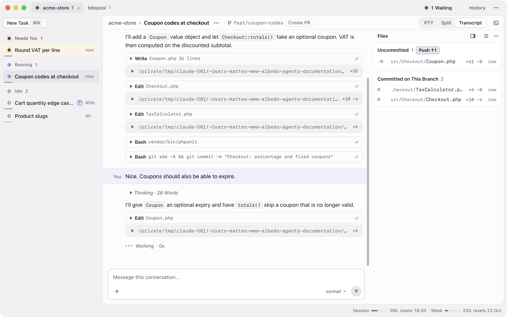
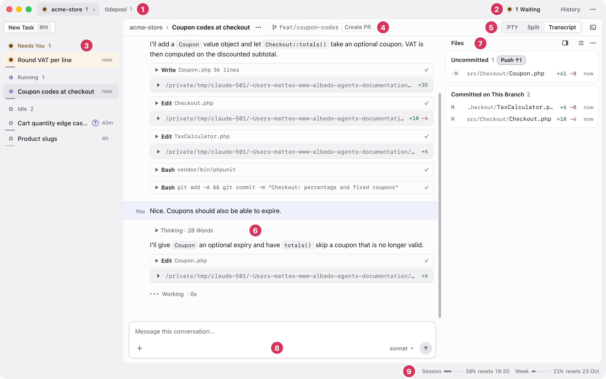
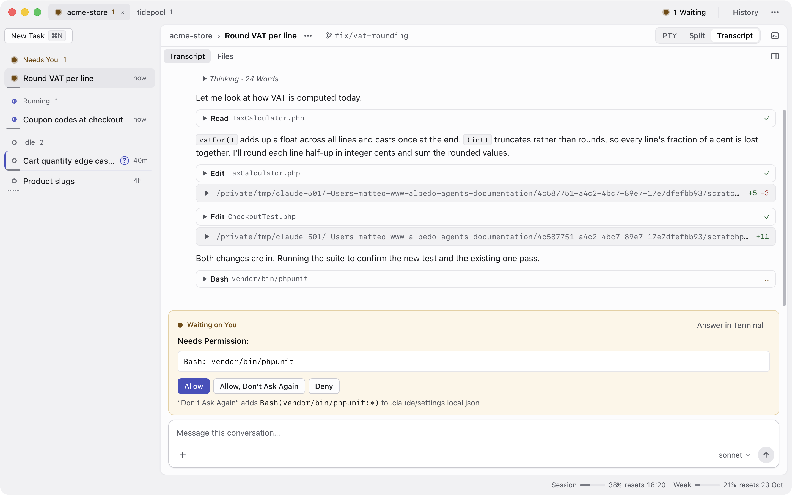
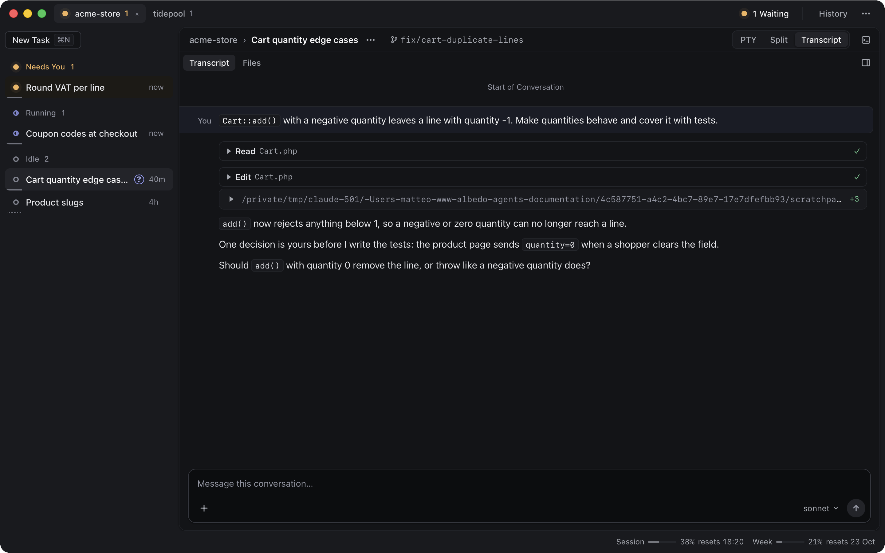

# Albedo

A desktop cockpit for running several Claude Code sessions at once.

Each piece of work is a **task**: its own branch, its own git worktree, and its
own Claude Code session. Albedo keeps them side by side, tells you which one is
waiting on you, and gives you a readable view of what each has done.

Albedo wraps Claude Code and never replaces it. Every task runs the real
`claude` in an embedded terminal, exactly as it would in your shell, so your
settings, hooks, skills, MCP servers and subscription all apply unchanged.



- [Requirements](#requirements)
- [Install](#install)
- [Getting started](#getting-started)
- [The window](#the-window)
- [What it does](#what-it-does)
- [Good to know](#good-to-know)
- [Keyboard shortcuts](#keyboard-shortcuts)
- [Troubleshooting](#troubleshooting)

## Requirements

Albedo runs on macOS and Linux, and on Windows as a Linux app under WSL2 (see
[docs/LINUX-WSL.md](docs/LINUX-WSL.md)).

| Tool | Needed for | Without it |
| --- | --- | --- |
| [Claude Code](https://claude.com/claude-code) (`claude`), signed in | Every task: Albedo runs it in the terminal | Nothing works |
| `git` | Worktrees, branches, the Files panel, Quick Open, Find in Files | Nothing works |
| [GitHub CLI](https://cli.github.com) (`gh`), signed in with `gh auth login` | The pull request badge: state, checks, merged | No PR status, and no hint saying why. Push and Create PR still work, because Claude runs `git` and `gh` itself in the terminal |
| [PHPantom](https://github.com/PHPantom-dev/phpantom_lsp), optional | Type-aware Go to Declaration and Find Usages in PHP | Navigation falls back to git grep |

To build Albedo you also need Node 22 or newer and a Rust toolchain
(`rustup`). On Linux, Tauri needs a few system libraries; the build script
prints the exact `apt-get` line if they are missing.

## Install

```sh
git clone https://github.com/bits4breakfast/albedo.git
cd albedo
./build.sh --install
```

The script checks the prerequisites, runs the tests, builds the app (`.app` on
macOS, `.deb` on Linux) and installs it: into `/Applications` on macOS, through
`apt` on Linux. Nothing is installed behind your back: a missing prerequisite
is reported with the command to run, and the script stops.

| Option | Does |
| --- | --- |
| `--with-phpantom` | Bundles PHPantom into the app (about 48 MB) |
| `--skip-checks` | Builds without running the type check and tests |
| `--help` | Lists everything |

Without `--install`, the built app and installers are left in
`src-tauri/target/release/bundle/`.

To install PHPantom separately instead of bundling it, run
`scripts/install-phpantom.sh`. It downloads a pinned release, checks its
SHA-256, and puts it in `~/.albedo/bin`. Albedo itself never downloads
anything.

## Getting started

1. **Add a project.** A project is a git repository Albedo cuts worktrees
   from. On first launch, click **Add a Project**; later, use
   **⋯ › Projects…**. Albedo can also create projects from the repositories
   your past Claude Code sessions ran in.
2. **Check the project's settings.**
   - **Worktree root**: where task worktrees go. It defaults to
     `~/agents/<project>`, outside the repository, so worktrees never show up
     as untracked files in your main checkout.
   - **Default base branch**: what new branches start from.
   - **Initial Prompt**, optional: text typed into every new session. It can
     use `{key}`, `{rest}`, `{title}` and `{branch}`.
3. **Create a task** with **⌘N**. Give it a title, pick a new or existing
   branch, and choose a new worktree or the main checkout. **⌘↩** creates it.
   Claude Code starts in the new worktree.
4. **Work as you normally would** in the terminal, or switch to the Transcript
   view (**⌘\\**) and write from the composer under it.

If the title starts with an issue key such as `ACME-142`, Albedo uses it in
the branch and folder names, and the Initial Prompt can name it with `{key}`
so Claude looks the issue up. Albedo itself never talks to an issue tracker: Claude Code
does that through its own MCP servers, so no tracker credentials end up in
Albedo.

## The window



1. **Project tabs.** One per repository, with a count of tasks waiting on you.
   **⌥1–9** switches. Tabs appear once there are two projects; a closed tab
   comes back from the closed-projects menu.
2. **Title bar actions.** **N Waiting** jumps to the next task that needs you.
   **History** opens past sessions. **⋯** holds Projects, Worktrees, the theme
   (System, Light or Dark) and Keyboard Shortcuts.
3. **Task list.** Tasks grouped as **Needs You**, **Running** and **Idle**,
   with the time since their last activity. **⌘1–9** jumps to a task and
   **⌘[** / **⌘]** steps through them. Each row's menu copies the worktree
   path or session ID, moves, archives or deletes the task.
4. **Task header.** Project, task title, the task's own menu (**⋯**), its
   branch, and the next step for the branch: Push, Create PR, or the open
   pull request.
5. **Layout.** **PTY** shows only the terminal, **Transcript** only the
   reading pane, **Split** both, side by side or stacked. **⌘\\** cycles
   through them. The icon next to it opens a shell in the main checkout (**⌥F12**).
6. **Transcript.** The conversation, read from Claude Code's session files:
   your messages, Claude's replies, tool calls and diffs.
7. **Files.** What this task changed: uncommitted changes, then commits on
   the branch. It can be a tab next to Transcript or, as here, a pinned
   column.
8. **Composer.** Write to Claude without going to the terminal. **+** or
   **⌘U** attaches files, and the menu on the right changes the task's model.
9. **Status strip.** Your plan's **Session** (five-hour) and **Week** usage,
   with the time each one resets.

## What it does

### See every session at a glance

The task list groups tasks by what they need from you. A task that ends its
turn on a question gets a **?** mark, so you can tell it is waiting for a
decision rather than finished.

When a task gets blocked or finishes while you are looking elsewhere, the dock
icon bounces, the row pulses, and a system notification says which task and
why.

### Answer permission prompts without hunting for the terminal

When Claude Code asks for permission, the question appears as a card under the
transcript: **Allow**, **Deny**, or **Allow, Don't Ask Again**. The last one
adds the rule Claude Code suggests and tells you exactly which rule and which
settings file. When Claude asks a question with options, the options are
buttons, plus a field for your own answer.



### Read the session instead of scrolling a terminal

Tool calls are compact rows, thinking folds away, and edits open into diffs
with word-level highlighting. Click any file path to open the file. **⌘↓**
jumps to the latest message.

When Claude starts subagents, a strip above the transcript shows them, and
clicking one opens that agent's own transcript. **Esc** goes back.

From the composer you can also **Clear** or **Compact** the task's context.



### Worktrees without the cleanup

- **New Task** cuts a fresh branch into its own worktree, checks out an
  existing branch (including a colleague's, as `origin/their-branch`), or
  uses the main checkout.
- **Move** takes a task between its worktree and the main checkout, with the
  same branch, the same conversation and the uncommitted changes.
- **Archive** and **Delete** ask what should happen to the worktree and the
  branch. The conversation is kept either way.
- **⋯ › Worktrees…** finds worktrees left behind: orphaned, locked, or with
  uncommitted changes.

### Review what changed

- **Files** lists every file the task touched, with line counts, either for
  the whole branch at once or grouped commit by commit.
- The **Editor** opens files in tabs. **⇧⌘D** switches between the file as it
  is now and this task's change to it. **⌘S** saves, and if Claude changed
  the file on disk since you opened it, Albedo refuses to overwrite it and
  says so.
- Select lines and press **⇧⌘C** to leave a review comment. Comments collect
  in the Files panel, and you send them to Claude in one go.
- The button at the top of Files moves the branch along: **Push**, then
  **Create PR**, then the pull request with its checks. **⇧⌘P** pushes,
  committing first if needed. **Squash & Rebase…** is in the menu next to it.
- When the pull request is merged, the task offers a follow-up task, archiving
  and deleting.

### Find your way around the code

- **⇧⇧** Search Everywhere, **⇧⌘O** Go to File (`:42` jumps to a line),
  **⌘O** Go to Class, **⌥⌘O** Go to Symbol.
- **⇧⌘F** Find in Files, with match case (**⌥C**) and regex (**⌥X**).
- **⌘B** or **⌘-click** Go to Declaration, **⌥F7** Find Usages.
- **⌥F12** opens a shell drawer in the main checkout. It keeps running while
  hidden.

### Get back to old conversations

**History** searches the full text of every conversation Albedo has captured,
and also lists Claude Code sessions it has not imported yet. Resume or fork any
of them into a task. If the session's worktree is gone, Albedo can recreate it,
use a checkout that has the branch, or resume in another folder.

## Good to know

**Albedo shows what Claude Code wrote down, not what the terminal drew.** The
transcript, statuses and diffs come from the session files Claude Code saves
on disk. Terminal output is never parsed, so a Claude Code update that changes
how the terminal looks cannot break Albedo's view of a session.

**Running means activity in the last 90 seconds.** A task with nothing new for
longer is Idle, unless it is waiting on you.

**The waiting card and the terminal prompt are the same prompt.** Answer
whichever is closer. If you answer in the terminal first, the card goes away
and a late click on it does nothing, so a prompt can never be answered twice.

**A task follows its session.** Typing `/clear` or `/resume` inside Claude Code
moves the task to the new session, and restarting Albedo resumes the session
the task was on.

**Your subscription, never the API.** Albedo removes `ANTHROPIC_API_KEY` from
every session it starts. An inherited key would silently bill the API instead
of your Claude subscription.

**Albedo sees your shell's PATH.** It starts `claude` through your login
shell, so the tools Claude uses are the ones you have in a terminal.

**Quitting asks first while tasks are busy.** Quitting stops every task's
`claude`. An idle task resumes on the next launch with nothing lost, but one
mid-turn or waiting on you would be interrupted, so ⌘Q and the close button
ask first. Quitting from the Dock does not ask yet.

**PHP navigation is navigation only.** PHPantom answers Go to Declaration and
Find Usages and nothing else: no completion, no diagnostics, and its
linters are switched off. It starts only when you open a PHP file. Without
it, the same commands use git grep.

**Where things live.**

| What | Where |
| --- | --- |
| Albedo's database (tasks, captured conversations, comments) | `~/Library/Application Support/com.bits4breakfast.albedo/` on macOS, `~/.local/share/com.bits4breakfast.albedo/` on Linux |
| Hook events, logs, PHPantom | `~/.albedo/` |
| Claude Code's own sessions, read only | `~/.claude/projects/` |
| Task worktrees | Each project's worktree root, `~/agents/<project>` by default |

Albedo captures only the conversations that belong to its tasks, plus the ones
you resume or import from History.

## Keyboard shortcuts

**⌘/** shows this list inside the app. On Windows and Linux, ⌘ is Ctrl.

| Keys | Action |
| --- | --- |
| ⌘N | New Task |
| ⌘↩ | Create the task (in New Task) |
| ⌘1…9 | Jump to the Nth task |
| ⌥1…9 | Jump to the Nth project |
| ⌘[ / ⌘] | Previous / next task |
| ⌘← / ⌘→ | Previous / next reading tab |
| ⌘\\ | Cycle PTY / Split / Transcript |
| ⇧⇧ | Search Everywhere |
| ⇧⌘O / ⌘O / ⌥⌘O | Go to File / Class / Symbol |
| ⇧⌘F | Find in Files |
| ⇧⌘P | Push the selected task (commits first) |
| ⌘U | Attach files to the message |
| ⌘↓ | Jump to the latest message |
| ⌘B or ⌘-click | Go to Declaration (in the editor) |
| ⌥F7 | Find Usages (in the editor) |
| ⇧⌘C | Comment on the selected lines (in the editor) |
| ⇧⌘D | File / this task's change (in the editor) |
| ⌥F12 | Shell in the main checkout |
| ⌘+ / ⌘− / ⌘0 | Bigger / smaller / actual-size text |
| ⌘/ | Show the shortcuts |

## Troubleshooting

**The terminal says `claude: command not found`.** Albedo starts `claude`
through your login shell. Make sure the shell profile that sets your `PATH`
(for example `~/.zprofile` or `~/.zshrc`) adds the folder `claude` is
installed in.

**No pull request badge.** Check `gh auth status` in a terminal. Albedo looks
for `gh` on its `PATH` and in `/opt/homebrew/bin`, `/usr/local/bin` and
`/usr/bin`. The branch also needs a GitHub remote and an open pull request.

**On Windows, statuses lag by up to 30 seconds.** Your repositories or
`~/.claude/projects` are on a Windows drive (`/mnt/c/...`), which does not
deliver file change events, so Albedo falls back to polling. Keep them on the
WSL filesystem; see [docs/LINUX-WSL.md](docs/LINUX-WSL.md).

**Go to Declaration finds text matches rather than the real declaration.**
PHPantom is not installed, so navigation uses git grep. Rebuild with
`./build.sh --with-phpantom` or run `scripts/install-phpantom.sh`.

---

Want to work on Albedo itself? Pull requests from forks are welcome: see
[CONTRIBUTING.md](CONTRIBUTING.md) for what to expect. Albedo is released
under the [MIT license](LICENSE).

The screenshots come from a sandboxed copy of the app with made-up projects
and conversations.

Named after Edoardo and Alberto (ALB + EDO). Albedo is the fraction of
incident light a surface reflects rather than absorbs. The app generates
nothing: it reflects a Claude Code session back in a readable form.
